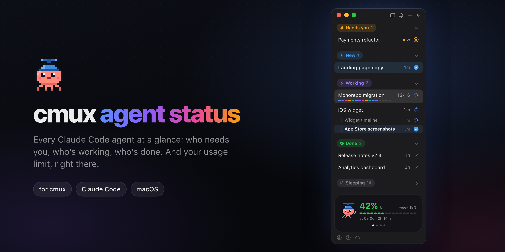
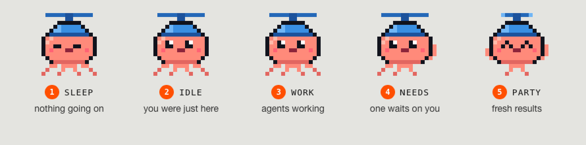
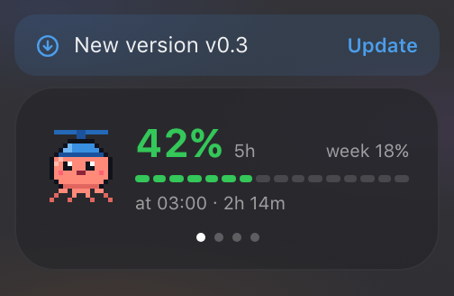

<p align="center">
  
</p>

<p align="center">
  <a href="https://github.com/manaflow-ai/cmux"></a>
  
  
  <a href="LICENSE"></a>
</p>

<p align="center">
  <a href="#install"><b>Install</b></a> ·
  <a href="#features"><b>Features</b></a> ·
  <a href="#updating"><b>Updating</b></a> ·
  <a href="#how-it-works"><b>How it works</b></a> ·
  <a href="docs/media/demo.mp4"><b>Video (28 s)</b></a>
</p>

# Claude sidebar for cmux

A sidebar for [cmux](https://github.com/manaflow-ai/cmux) when most of your tabs run Claude Code: workspaces grouped by what they need from you, with the state of every agent at a glance, and your Claude usage limit on top.

<p align="center">
  
</p>

## Features

### Sorted by what needs you

<table>
<tr>
<td colspan="2" align="center"><br><br><br><b>Sections by attention</b><br><sub>Needs you · New · Working · No task yet · Done · Sleeping</sub><br><br></td>
</tr>
<tr>
<td width="50%" align="center" valign="top"><br><br><br><b>Real “last time you wrote here”</b><br><sub>From Claude’s transcripts, survives restarts</sub><br><br></td>
<td width="50%" align="center" valign="top"><br><br><br><b>Background work counts</b><br><sub>Stays in Working while tests or agents run</sub><br><br></td>
</tr>
<tr>
<td width="50%" align="center" valign="top"><br><br><br><b>Agent progress</b><br><sub>Segments fill as background agents finish</sub><br><br></td>
<td width="50%" align="center" valign="top"><br><br><br><b>Tabs under their workspace</b><br><sub>Each with its own state</sub><br><br></td>
</tr>
<tr>
<td width="50%" align="center" valign="top"><br><br><br><b>Drag to sleep</b><br><sub>Wakes when you write there again</sub><br><br></td>
<td width="50%" align="center" valign="top"><br><br><br><b>Close asks first</b><br><sub>× turns into “Close?”, like Cmd+W</sub><br><br></td>
</tr>
</table>

<details>
<summary>How each one works</summary>

- **Needs you**: a permission prompt or a question is open. **New**: done, not read yet (tinted blue). **No task yet**: a workspace you just opened. **Sleeping**: no prompt for a day, or parked by hand.
- **Last time you wrote here** is read from Claude's transcripts; cmux resets its own timestamps on restart, which turned every tab into "22h".
- **Background work**: Claude ended its turn, but a background command or background agents are still running and it will pick up on its own. An idle dev server doesn't count.
- **Progress** comes from the agents' own transcripts ("12/16") while a batch runs.
- **Sleep**: drag a row into Sleeping or right-click → Put to sleep.
- **Close**: the × on a row turns into a red "Close?", and only a second click closes it.

</details>

### An activity card, like an iPhone Live Activity

Click the card or a dot to flip pages.

<table>
<tr>
<td width="50%" align="center" valign="top"><br><br><br><b>Usage limit</b><br><sub>5-hour and weekly, with the reset time</sub><br><br></td>
<td width="50%" align="center" valign="top"><br><br><br><b>Focus timer</b><br><sub>25 minutes, then a notification</sub><br><br></td>
</tr>
<tr>
<td width="50%" align="center" valign="top"><br><br><br><b>Today</b><br><sub>Prompts, hours, agents, streak</sub><br><br></td>
<td width="50%" align="center" valign="top"><br><br><br><b>This project</b><br><sub>Time and prompts in this workspace</sub><br><br></td>
</tr>
</table>

<details>
<summary>How each one works</summary>

- **Limit**: the 5-hour Claude Code limit with a bar, when it resets and in how long, plus the weekly one, so you don't open the Claude app just to check.
- **Today**: hours count time with at least one Claude session active, so parallel sessions count once; agents are background agents started today; the streak is days in a row.
- **This project**: time and prompts in the selected workspace's Claude sessions.

</details>

### A pixel octopus in a propeller beanie

<p align="center"></p>

<p align="center"><sub>Asleep when nothing happens, spins its propeller while agents work, waves when one waits on you, celebrates fresh results.</sub></p>

### Small things that add up

<table>
<tr>
<td width="50%" align="center" valign="top"><br><br><br><b>Latest download</b><br><sub>AirDrop a screenshot, paste it into Claude in one click</sub><br><br></td>
<td width="50%" align="center" valign="top"><br><br><br><b>Tab strip buttons</b><br><sub>A Claude tab, or Claude on a new branch</sub><br><br></td>
</tr>
<tr>
<td width="50%" align="center" valign="top"><br><br><br><b>Cmd+N opens Claude</b><br><sub>New workspaces start with Claude running</sub><br><br></td>
<td width="50%" align="center" valign="top"><br><br><br><b>Right-click → Open here</b><br><sub>Worktree, second Claude, preview, simulator</sub><br><br></td>
</tr>
<tr>
<td width="50%" align="center" valign="top"><br><br><br><b>Cmd+1…9 follow the sidebar</b><br><sub>Cmd+1 is always the top row</sub><br><br></td>
<td width="50%" align="center" valign="top"><br><br><br><b>English or Ukrainian</b><br><sub>Right-click a header to switch</sub><br><br></td>
</tr>
</table>

<details>
<summary>How each one works</summary>

- **Latest download**: when a file lands in ~/Downloads, a chip above the card pastes it into the open Claude tab, where it becomes an image attachment.
- **Tab strip buttons**: the branch one runs `claude -w` for parallel fixes. If the workspace folder isn't a git repo (a notes vault where Claude edits code elsewhere), it finds the repo from the paths its sessions worked on and asks before using it.
- **Cmd+N** needs the config snippet; a plain terminal is a right-click on "+".
- **Open here**: Claude on its own git worktree, a second Claude, the local site in the Dock, an iOS simulator.
- **Cmd+1…9**: cmux's own workspace order is kept in step with the sections, so the numbers move as workspaces change section.
- **Language** follows macOS; switch with right-click on the activity card or any section header.
- **Working indicator**: three dots by default; the same right-click → **Working indicator** offers a colour-changing icon, a pulse or a braille spinner.

</details>

## Install

Needs macOS. One command:

```sh
curl -fsSL https://raw.githubusercontent.com/sahneo/cmux-claude-sidebar/master/install.sh | bash
```

It fetches the latest release into `~/.cmux-claude-sidebar` and offers to install cmux with Homebrew (`brew install --cask cmux`) if it's missing. Then it links the sidebar into `~/.config/cmux` and adds only the missing keys from [`config/cmux.snippet.jsonc`](config/cmux.snippet.jsonc) to your `cmux.json`. It backs the file up first and keeps the values you already set. For the limit card it sets a minimal Claude Code status line if you have none, and if you have your own it shows the two lines to add. Finally it loads two small launchd jobs and selects the sidebar. The glass sidebar (with a solid terminal) is a y/N question. To see what it would do without changing anything, run `curl -fsSL … | bash -s -- --dry-run`.

### Or paste this into Claude Code

```text
Install the Claude sidebar for cmux for me by following
https://github.com/sahneo/cmux-claude-sidebar/blob/master/INSTALL.md
```

Claude reads [INSTALL.md](INSTALL.md), shows you the plan, asks about the glass sidebar, installs and checks the result.

### By hand

Needs cmux ≥ 0.65 (`brew install --cask cmux`; custom sidebars beta, on by default) and Python 3 (macOS ships it).

```sh
git clone https://github.com/sahneo/cmux-claude-sidebar ~/.cmux-claude-sidebar
~/.cmux-claude-sidebar/install.sh --dry-run   # what it would change
~/.cmux-claude-sidebar/install.sh             # puts the clone on the latest release, then installs
```

A clone anywhere else counts as your own working copy: `install.sh` installs it exactly as it is, and you update it with git.

What the script does, if you'd rather do it yourself:

1. Merge `config/cmux.snippet.jsonc` into `~/.config/cmux/cmux.json` and run `cmux reload-config`.
2. For the limit card, let your Claude Code [status line](https://docs.claude.com/en/docs/claude-code/statusline) script save the limits it receives (needs `jq`):

   ```sh
   limits=$(echo "$input" | jq -c '.rate_limits // empty')
   [ -n "$limits" ] && printf '%s' "$limits" > "$HOME/.claude/rate-limits.json"
   ```

The `automation` socket mode in the snippet is required: the sync job runs from launchd, outside cmux. `config/ghostty.config` is optional, part of the glass sidebar: it keeps the terminal opaque next to the glass, with a softer background (the themes in `config/themes`, off-white in light mode, dark gray in dark) and some room from the sidebar's edge; it goes to `~/.config/ghostty/config`. The glass itself is cmux's sidebar material (`defaults write com.cmuxterm.app sidebarMaterial -string menu`, `sidebarBlendMode -string behindWindow`, and `sidebarState -string active` so it stays glass when the window isn't focused) and doesn't need a translucent terminal. A theme picked in cmux's Settings → Themes wins over the soft one; the installer says so when it finds one.

Uninstall: right-click the sidebar button → Workspaces, then stop the background jobs: `launchctl bootout gui/$(id -u)/com.propeller.cmux-last-prompt` and `…/com.propeller.cmux-window-watch`. Your previous settings are in `~/.config/cmux/cmux.json.bak-*` and `~/.claude/settings.json.bak-*`.

## Updating



You get releases (`v0.2.0`, `v0.3.0`, …), not every commit on master. Once a day the sync job asks GitHub whether a newer release is out (one request, no token; offline it waits for the next day). When there is one, a **New version** chip shows above the activity card:

- **click** it to update: a terminal tab opens and runs `~/.config/cmux/update.sh`, so you see what it does;
- **right-click** → *What's new* opens the release page, *Hide this version* hides the chip until the next release.

Nothing updates on its own. From a terminal it's the same:

```sh
sh ~/.config/cmux/update.sh
```

It moves `~/.cmux-claude-sidebar` to the newest release and repeats only the install steps a new version can need: the links, the Swift helpers (rebuilt when their source changed), the `cmux.json` keys you don't have yet (yours are never overwritten), the launchd jobs (reloaded only when their plist changed) and `cmux reload-config`. It prints what changed; run again, it changes nothing.

Want everything as soon as it's on master (less tried, may break)? Add `--master`: `curl -fsSL … | bash -s -- --master`, or `install.sh --master`. `update.sh` then pulls master, and there's no chip; `--releases` goes back.

The installer and `update.sh` only move their own clone. If the sidebar runs from a clone of your own (on a branch, or with local changes), there's no chip, and `update.sh` says so and leaves it alone.

## How it works

| Piece | Where | What |
| --- | --- | --- |
| `sidebars/agent-status.js` | `~/.config/cmux/sidebars/` | The sidebar (cmux's reactive JS runtime). Started from cmux's bundled `workspaces.js` template. |
| `scripts/last-prompt-sync.py` | `~/.config/cmux/` | Every 15 s: last prompt per workspace from the Claude transcripts, background work, agent progress, usage limits. Writes them into the workspace description (`last prompt @<epoch> · bg · zz@<epoch>`, plus `lim:… · lang:…` on one workspace), the only field an outside process can set and a sidebar can read. Leaves descriptions in any other format alone. |
| `scripts/update.sh` | `~/.config/cmux/update.sh` | Moves the install to the newest release and re-runs `install.sh --update`. The New version chip runs it; the sync job writes `upd:<tag>:<release page>` on one workspace when GitHub has a newer release (checked once a day). |
| `scripts/extract-claude-icon.swift` | run by `install.sh` | Copies cmux's own Claude icon to `~/.config/cmux/icons/claude.png` for the tab-strip button. |
| `launchd/com.propeller.cmux-last-prompt.plist` | `~/Library/LaunchAgents/` | Runs the sync job. Log: `~/.config/cmux/last-prompt-sync.log`. |
| `scripts/window-watch.swift` + `launchd/com.propeller.cmux-window-watch.plist` | `~/.config/cmux/bin/`, `~/Library/LaunchAgents/` | Watches cmux's window height and the newest file in ~/Downloads and passes them on (`last-prompt-sync.py --window` / `--download`). |

Gotchas found on the way (cmux 0.65.2):

- `ProgressView()` ignores `.frame` and overflows the row; the spinner is an SF Symbol rotated on the clock tick.
- `.monospacedDigit()` and `.disabled()` don't exist in the JS runtime, and menu items can't be hidden.
- cmux reports `backgroundWorkPending` for an idle background server too, and older Claude versions never wrote `finished` into subagent meta files, so neither is trusted on its own.
- The sidebar scrolls as one piece and doesn't know the window height, so nothing can be pinned to its bottom. A tiny Swift watcher (`scripts/window-watch.swift`, built by `install.sh`, kept alive by launchd, ~0.1% CPU) reports cmux's window height on every resize, every row has a fixed height, and a spacer pushes the card down. It follows a resize within about a second, which is how often cmux refreshes sidebar data. Sleeping starts folded so the list fits.
- `workspace.close` refuses a workspace whose terminal runs a process (Claude does) until it gets `force: true`; the row's ✕ forces it, and a row whose close didn't happen comes back after 3 s.
- cmux names a workspace after its focused tab; opening a simulator renamed it to "Simulator". The sidebar keeps the Claude tab's name.

## Images and video

Everything in `docs/media` is drawn from [`docs/media/src/scene.html`](docs/media/src/scene.html): a recreation of the sidebar with demo data (the live one shows real workspace names), with the octopus read straight from `sidebars/agent-status.js`. After a design change:

```sh
cd docs/media/src && npm ci
node render.mjs stills   # hero.png, social-preview.png, window.png, cards.png, octopus.gif
node render.mjs video    # demo.mp4 and demo.gif
node render.mjs social   # out/demo-vertical.mp4 (9:16) and out/poster.png (4:5)
node render.mjs features         # features/*.gif, one loop per feature
node render.mjs features close   # just one (names: the FEATS keys in scene.html)
node render.mjs peek 16x9 12.5   # one frame of the video, to check a scene
node render.mjs fpeek close 1.8  # one frame of a feature loop
```

Needs ffmpeg (`brew install ffmpeg`).

## Licence

GPL-3.0-or-later, like cmux: `sidebars/agent-status.js` started from cmux's `workspaces.js` sidebar template.
