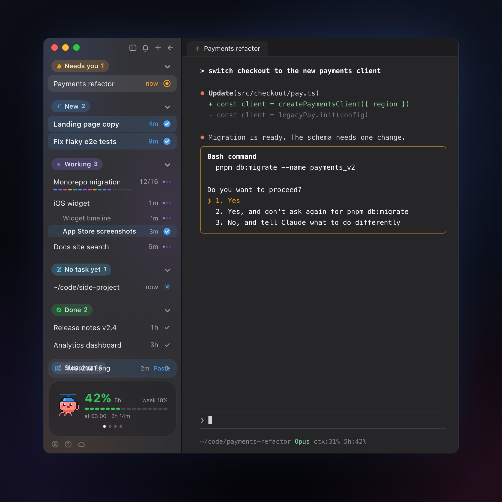
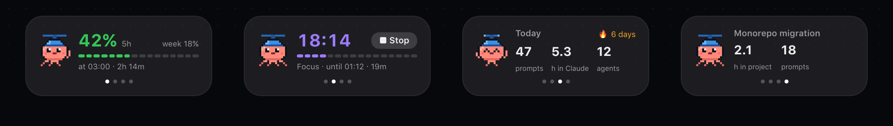

<p align="center">
  
</p>

<p align="center">
  <a href="https://github.com/manaflow-ai/cmux"></a>
  
  
  <a href="LICENSE"></a>
</p>

<p align="center">
  <a href="#install"><b>Install</b></a> ·
  <a href="#features"><b>Features</b></a> ·
  <a href="#how-it-works"><b>How it works</b></a> ·
  <a href="docs/media/demo.mp4"><b>Video (28 s)</b></a>
</p>

# cmux agent status

A sidebar for [cmux](https://github.com/manaflow-ai/cmux) when most of your tabs run Claude Code: workspaces grouped by what they need from you, with the state of every agent at a glance, and your Claude usage limit on top.

<p align="center">
  
</p>

## Features

### Sorted by what needs you



<table>
<tr>
<td width="50%" valign="top"><br><b>Sections by attention</b>, as coloured pills: Needs you (a permission prompt or a quiz is open) · New (done, not read yet, tinted blue) · Working · No task yet (a workspace you just opened) · Done · Sleeping (no prompt for a day).</td>
<td width="50%" valign="top"><br><b>Real "last time you wrote here"</b>, read from Claude's transcripts, so a cmux restart doesn't turn every tab into "22h".</td>
</tr>
<tr>
<td width="50%" valign="top"><br><b>Background work counts as working</b>: Claude ended its turn but a background command or background agents are still running and it will pick up on its own. An idle dev server doesn't count.</td>
<td width="50%" valign="top"><br><b>Progress of background agents</b> as segments ("12/16") while a batch runs.</td>
</tr>
<tr>
<td width="50%" valign="top"><br><b>Tabs under their workspace</b> once it has more than one, each with its own state.</td>
<td width="50%" valign="top"><br><b>Park a workspace</b>: drag it into Sleeping (or right-click → Put to sleep). It wakes when you write in it again.</td>
</tr>
<tr>
<td width="50%" valign="top"><br><b>Close asks first</b>: the × on a row turns into a red "Close?" and only a second click closes, like Cmd+W.</td>
<td width="50%"></td>
</tr>
</table>

### An activity card, like an iPhone Live Activity



Pages flip with a click on the card or a dot (cmux sidebars get no swipe gestures):

<table>
<tr>
<td width="50%" valign="top"><br><b>Limit</b>: the 5-hour Claude Code limit with a bar, when it resets and in how long, plus the weekly one, so you don't open the Claude app just to check.</td>
<td width="50%" valign="top"><br><b>Focus</b>: a 25-minute timer with a notification at the end.</td>
</tr>
<tr>
<td width="50%" valign="top"><br><b>Today</b>: prompts sent, hours with at least one Claude session active (parallel sessions count once), background agents started, and how many days in a row you've been at it.</td>
<td width="50%" valign="top"><br><b>This project</b>: time and prompts in the selected workspace's Claude sessions.</td>
</tr>
</table>

### A pixel octopus in a propeller beanie


It lives on the card: asleep when nothing happens, spinning its propeller while agents work, waving when one waits on you, celebrating fresh results.

### Small things that add up

<table>
<tr>
<td width="50%" valign="top"><br><b>Latest download, one click away</b>: when a file lands in ~/Downloads (say, a screenshot AirDropped from the iPhone), a chip above the card pastes it into the open Claude tab, where it becomes an image attachment.</td>
<td width="50%" valign="top"><br><b>Cmd+N opens Claude</b> (with the config snippet): new workspaces start with Claude running; a plain terminal is a right-click on "+".</td>
</tr>
<tr>
<td width="50%" valign="top"><br><b>Right-click → Open here</b>: Claude on its own git worktree, a second Claude, the local site in the Dock, an iOS simulator.</td>
<td width="50%" valign="top"><br><b>Tab strip buttons</b>: a Claude tab and a Claude-on-a-new-branch tab (<code>claude -w</code>) for running several fixes in parallel. If the workspace folder isn't a git repo (a notes vault where Claude edits code elsewhere), the branch button finds the repo from the paths its sessions worked on.</td>
</tr>
<tr>
<td width="50%" valign="top"><br><b>Cmd+1…9 follow the sidebar</b>: cmux's own workspace order is kept in step with the sections, so Cmd+1 is always the top row (the numbers move as workspaces change section).</td>
<td width="50%" valign="top"><br><b>English or Ukrainian</b>: follows macOS; switch with right-click on the activity card or any section header.</td>
</tr>
</table>

## Install

Needs macOS. One command:

```sh
curl -fsSL https://raw.githubusercontent.com/sahneo/cmux-agent-status/master/install.sh | bash
```

It fetches the repo into `~/.cmux-agent-status` and offers to install cmux with Homebrew (`brew install --cask cmux`) if it's missing. Then it links the sidebar into `~/.config/cmux` and adds only the missing keys from [`config/cmux.snippet.jsonc`](config/cmux.snippet.jsonc) to your `cmux.json`. It backs the file up first and keeps the values you already set. For the limit card it sets a minimal Claude Code status line if you have none, and if you have your own it shows the two lines to add. Finally it loads two small launchd jobs and selects the sidebar. The glass terminal is a y/N question. To see what it would do without changing anything, run `curl -fsSL … | bash -s -- --dry-run`.

### Or paste this into Claude Code

```text
Install the cmux agent status sidebar for me by following
https://github.com/sahneo/cmux-agent-status/blob/master/INSTALL.md
```

Claude reads [INSTALL.md](INSTALL.md), shows you the plan, asks about the glass terminal, installs and checks the result.

### By hand

Needs cmux ≥ 0.65 (`brew install --cask cmux`; custom sidebars beta, on by default) and Python 3 (macOS ships it).

```sh
git clone https://github.com/sahneo/cmux-agent-status ~/code/cmux-agent-status
~/code/cmux-agent-status/install.sh --dry-run   # what it would change
~/code/cmux-agent-status/install.sh
```

What the script does, if you'd rather do it yourself:

1. Merge `config/cmux.snippet.jsonc` into `~/.config/cmux/cmux.json` and run `cmux reload-config`.
2. For the limit card, let your Claude Code [status line](https://docs.claude.com/en/docs/claude-code/statusline) script save the limits it receives (needs `jq`):

   ```sh
   limits=$(echo "$input" | jq -c '.rate_limits // empty')
   [ -n "$limits" ] && printf '%s' "$limits" > "$HOME/.claude/rate-limits.json"
   ```

The `automation` socket mode in the snippet is required: the sync job runs from launchd, outside cmux. `config/ghostty.config` is optional: a glass terminal, with extra left padding because a translucent cmux pane shows a 1 pt seam where text would start; it goes to `~/.config/ghostty/config`.

Update: run the install command again (or `git pull` in the clone: the installed files are symlinks, and cmux hot-reloads the sidebar).

Uninstall: right-click the sidebar button → Workspaces, then stop the background jobs: `launchctl bootout gui/$(id -u)/com.propeller.cmux-last-prompt` and `…/com.propeller.cmux-window-watch`. Your previous settings are in `~/.config/cmux/cmux.json.bak-*` and `~/.claude/settings.json.bak-*`.

## How it works

| Piece | Where | What |
| --- | --- | --- |
| `sidebars/agent-status.js` | `~/.config/cmux/sidebars/` | The sidebar (cmux's reactive JS runtime). Started from cmux's bundled `workspaces.js` template. |
| `scripts/last-prompt-sync.py` | `~/.config/cmux/` | Every 15 s: last prompt per workspace from the Claude transcripts, background work, agent progress, usage limits. Writes them into the workspace description (`last prompt @<epoch> · bg · zz@<epoch>`, plus `lim:… · lang:…` on one workspace), the only field an outside process can set and a sidebar can read. Leaves descriptions in any other format alone. |
| `scripts/extract-claude-icon.swift` | run by `install.sh` | Copies cmux's own Claude icon to `~/.config/cmux/icons/claude.png` for the tab-strip button. |
| `launchd/com.propeller.cmux-last-prompt.plist` | `~/Library/LaunchAgents/` | Runs the sync job. Log: `~/.config/cmux/last-prompt-sync.log`. |
| `scripts/window-watch.swift` + `launchd/com.propeller.cmux-window-watch.plist` | `~/.config/cmux/bin/`, `~/Library/LaunchAgents/` | Watches cmux's window height and the newest file in ~/Downloads and passes them on (`last-prompt-sync.py --window` / `--download`). |

Gotchas found on the way (cmux 0.65.2):

- `ProgressView()` ignores `.frame` and overflows the row; the spinner is an SF Symbol rotated on the clock tick.
- `.monospacedDigit()` and `.disabled()` don't exist in the JS runtime, and menu items can't be hidden.
- cmux reports `backgroundWorkPending` for an idle background server too, and older Claude versions never wrote `finished` into subagent meta files, so neither is trusted on its own.
- The sidebar scrolls as one piece and doesn't know the window height, so nothing can be pinned to its bottom. A tiny Swift watcher (`scripts/window-watch.swift`, built by `install.sh`, kept alive by launchd, ~0.1% CPU) reports cmux's window height on every resize, every row has a fixed height, and a spacer pushes the card down. It follows a resize within about a second, which is how often cmux refreshes sidebar data. Sleeping starts folded so the list fits.
- `workspace.close` refuses a workspace whose terminal runs a process (Claude does) until it gets `force: true`; the row's ✕ forces it, and a row whose close didn't happen comes back after 3 s.
- cmux names a workspace after its focused tab; opening a simulator renamed it to "Simulator". The sidebar keeps the Claude tab's name.

## Images and video

Everything in `docs/media` is drawn from [`docs/media/src/scene.html`](docs/media/src/scene.html): a recreation of the sidebar with demo data (the live one shows real workspace names), with the octopus read straight from `sidebars/agent-status.js`. After a design change:

```sh
cd docs/media/src && npm ci
node render.mjs stills   # hero.png, window.png, cards.png, octopus.gif
node render.mjs video    # demo.mp4 and demo.gif
node render.mjs social   # out/demo-vertical.mp4 (9:16) and out/poster.png (4:5)
node render.mjs features         # features/*.gif, one loop per feature
node render.mjs features close   # just one (names: the FEATS keys in scene.html)
node render.mjs peek 16x9 12.5   # one frame of the video, to check a scene
node render.mjs fpeek close 1.8  # one frame of a feature loop
```

Needs ffmpeg (`brew install ffmpeg`).

## Licence

GPL-3.0-or-later, like cmux: `sidebars/agent-status.js` started from cmux's `workspaces.js` sidebar template.
